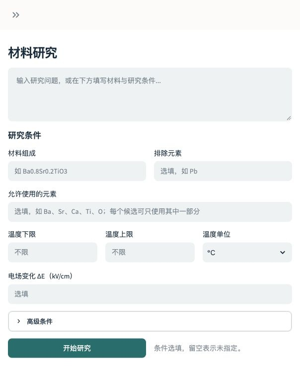
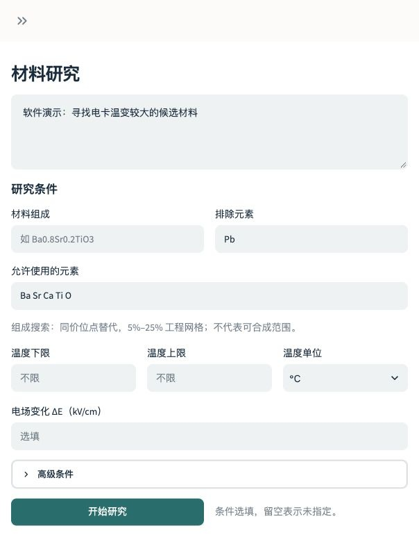
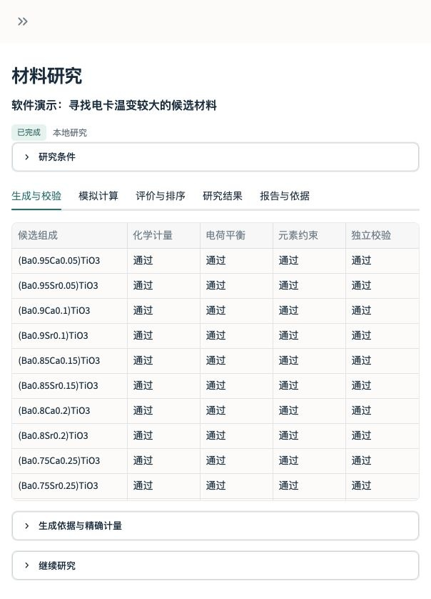
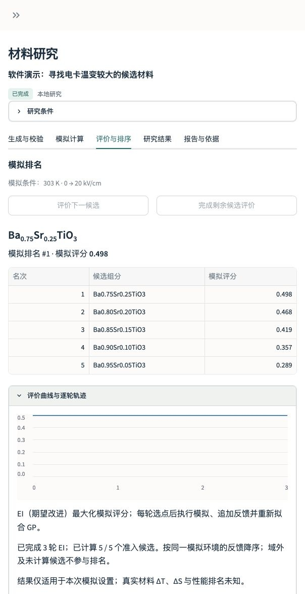
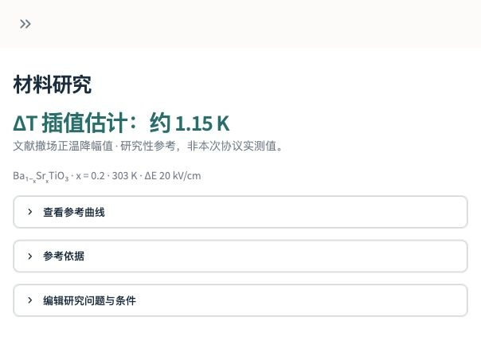
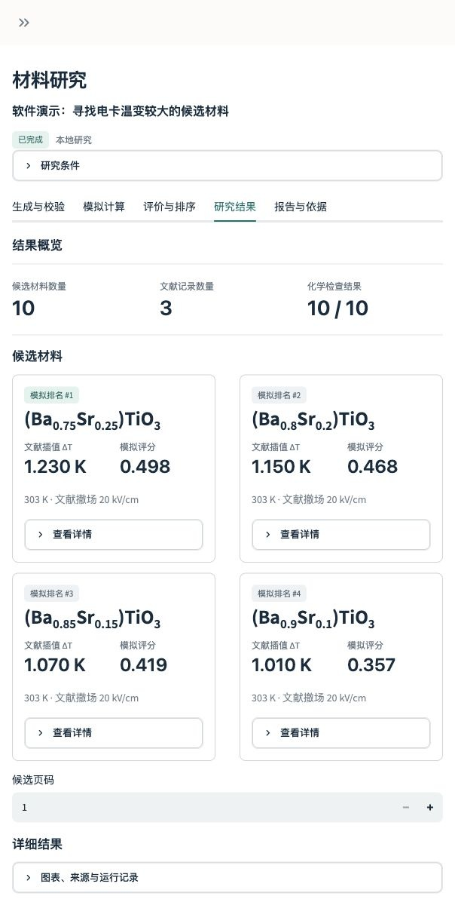
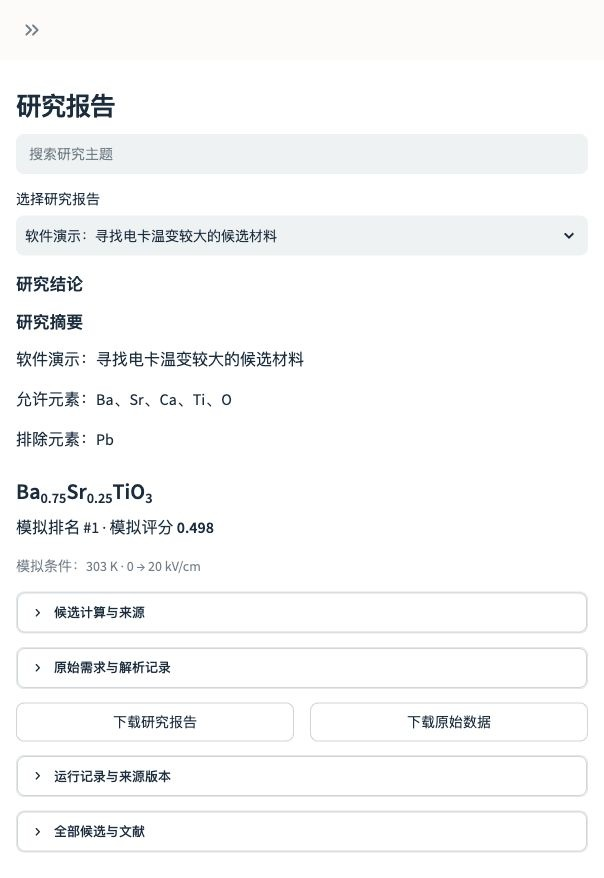

# ECalX · 材料研究工作台

**v0.2.0-beta.3** · Python 包 `0.2.0b3` · 本地发布候选，等待最终确认。

使用自己的材料数据和可选 API，在本机完成：研究目标与元素输入 → 候选生成 → 化学校验 → M4 虚拟实验与主动学习 → 温变计算 → 研究结果 → 报告下载。

## 安装与启动

Python 3.11+。下载本版本源码并进入 ECalX 目录后执行：

```sh
python3.11 -m venv .venv
source .venv/bin/activate
python -m pip install .
ecalx
```

打开终端显示的本机地址。默认监听 `127.0.0.1`，关闭 Streamlit 使用统计。源码入口：

```sh
python -m streamlit run app.py --server.address=127.0.0.1 --browser.gatherUsageStats=false
```

Windows 可用 `.venv\Scripts\activate` 激活环境；本次实测平台为 macOS ARM64 / Python 3.11，其他平台未实测。依赖通过 pip 安装，无需作者的相邻工程、数据库、模型或 CUDA。

## 使用自己的数据与 API

1. 在“设置 → 数据库构建”导入 CSV/Excel 并核对字段，或本地解析可搜索 PDF 后人工核对。至少提供化学式和可追溯来源；未知温度、电场、性能保持空白。[原创合成示例](examples/README.md)可用于完整软件流程演练，不是科研证据。
2. 在研究工作台填写研究目标、允许元素和排除元素。其他条件选填，不暗设无铅、温区或材料家族。程序从可追溯种子按既有规则枚举组成并逐个执行独立化学校验；没有适用来源时显示空态。
3. 确认研究条件和工具计划后执行。完成后可在同一研究中运行严格准入的 M4 虚拟实验、固定 RBF GP/EI 主动学习和模拟排名；域外候选保留待研究，不补数字。
4. 在历史研究重开任务，在研究结果查看分页卡片与依据，在研究报告下载 Markdown 和完整 JSON。大记录、图表和下载按需生成，避免默认渲染巨量 JSON 导致卡顿。

本地研究无需 API Key。在“设置 → API 配置”可选填自己的 SiliconFlow Key 与可用、支持 Function Calling 的 DeepSeek 模型。在线执行前仍需确认用量及发送范围，供应商可能收费；本次未调用付费 API，未宣称已通过真实供应商在线验收。

数据和历史默认保存在 `~/.local/share/ecalx`（可设 `ECALX_WORKSPACE`）；Key 和 API 配置默认保存在 `~/.config/ecalx`（可设 `ECALX_CONFIG_DIR`）。不要提交自己的配置、资料和工作区。

## ΔT 与模拟评分

| 结果 | 来源与条件 | 如何理解 |
| --- | --- | --- |
| 模拟评分 | M4 `maxwell-toy-1` 未校准演示环境，按同一 run 的冻结条件排序 | 不带 K，不代表真实 ΔT、实验性能或材料最优结论 |
| 文献插值 ΔT | 工作台内部 BST 插值器；须自备合法取得且哈希匹配的参考 CSV | 文献撤场正温降幅值的研究性参考，带 K；不代表当前加载路径实测结果 |
| RF/XGBoost 研究性 ΔT | 保留既有个人模式接口与卡片连接；须显式配置原科研工程和匹配工件 | 文献原报告 ΔT 标签的离线估计，未经独立最终外测；公开包不附私人权重、训练集或科研 ML 工程 |

BST 适用范围：未掺杂 Ba₁₋ₓSrₓTiO₃ **块体陶瓷**，x=0.05–0.35；标称撤场幅值仅 10、20、30 kV/cm；温度限于支撑曲线实际覆盖交集，不外推。Ca 掺杂、薄膜及越界条件不输出插值值。

先在“设置 → 数据库构建 → 参考曲线”导入一次有权使用的冻结 204 点 CSV（原版或脱敏副本），再在研究工作台填写 `Ba0.8Sr0.2TiO3`、温度下限和上限均为 `303` K、ΔE `20` kV/cm，点击“计算电卡温变”，可得约 **1.15 K** 的文献参考值。支撑曲线按需展开；结果可随研究保存，并写入报告。参考 CSV 缺失或校验失败时不提供该数值。

参考数据是 1 篇论文、12 条曲线的 204 个相关读图点，不是 204 次独立实验。论文 PDF、原图和数字化数值集均不分发；[空白格式模板](ecalx_local/templates/BST_reference_template.csv)不能直接用于计算。来源：[Dai 等，DOI 10.1111/ijac.13384](https://doi.org/10.1111/ijac.13384)。详见[计算方法](docs/bst_interpolation_20261021.md)、[数据许可](docs/bst_data_license.md)和[本版科学功能核验](docs/scientific_capabilities.md)。

本次已实际检查原 RF/XGBoost direct/indirect 四种离线推理及拒答边界；公开 BYO 安装仍明确显示模型不可用。不能把未知路径改写成已知路径，不能以模拟评分代替 ΔT，也不能将研究性估计宣传为实验验证。所有生成组成仍为 `generated_unverified`，正式 M5 推荐未启用。

## 项目演示

以下为最终 beta.3 实际浏览器截图。候选生成使用公开 CC0 合成软件输入；ΔT 展示另使用仅保留在本机、哈希匹配的文献参考文件。公开包不包含该参考数值集，安装后需自行合法导入。截图中的分值与温变分别标注，完整文献曲线和私人实验记录不出现在演示图中。[截图说明与来源](docs/screenshots/README.md)。

| 研究工作台 | 研究目标与元素输入 |
| --- | --- |
|  |  |

| 候选生成与化学校验 | 虚拟实验与主动学习 |
| --- | --- |
|  |  |

| 温变计算 | 研究结果 |
| --- | --- |
|  |  |



## 验证与版本说明

```sh
python -m pip install '.[dev]'
python -B -m pytest -q
python scripts/audit_release.py
```

数值集未分发，未配置 `ECALX_BST_TEST_CSV` 的数值集成测试会明确跳过；本次另以合法本地冻结数据执行完整数值测试。见[验证结果](docs/validation.md)、[更新记录](CHANGELOG.md)与[可直接使用的 Release Notes](docs/release_notes.md)。

源码沿用 [MIT License](LICENSE)。第三方依赖保留各自许可；论文、用户数据、私人模型和科研资产不因项目 MIT 许可而获得再分发许可。详见[发行范围](docs/release_scope.md)、[第三方许可](docs/third_party.md)及 `audit/public_files.txt`、`audit/SHA256SUMS`。

**English:** A local materials research workbench with bring-your-own data and optional API. Element-constrained candidates, independent chemistry checks, M4 simulation and GP/EI optimization, traceable literature interpolation, history and downloadable reports. Simulation scores are not ΔT. BST reference data and private ML artifacts are not bundled; research estimates are not experimentally verified predictions.
