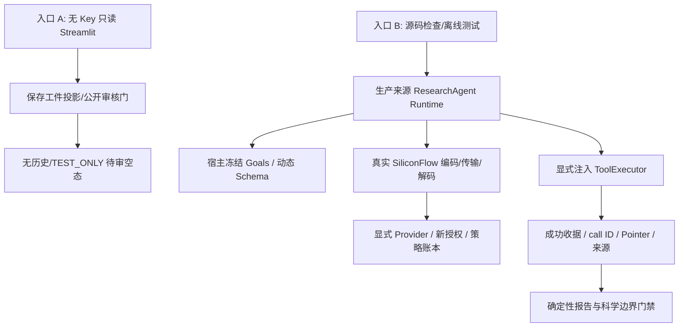

# 当前 TEST_ONLY 发布规则

采用所有者审核与绑定完整发行范围的独立回执，见 clean_demo.md；下文原 v1 独立审核门描述仅供历史背景，已由当前治理规则替代。真实核心不变。

# 发行版架构

入口 A 不加载在线客户端、Runtime、任务存储或科研服务。入口 B 的检查脚本只解析 AST；核心 pytest 在拒绝 socket/DNS 的环境下运行真实 Runtime 和策略，只用显式 TEST_ONLY 工具/HTTP 替身。

本轮纳入、原样模块、适配范围、排除原因与未来集成接口见 [Agent 核心评估](agent_core.md)。生产来源和最终字节双哈希见 audit/agent_source_provenance.json；所有文件白名单与 SHA256 覆盖整个独立候选。

原完整项目实验服务、数据库、模型、历史摘要自动验收链和真实轨迹均未收录。公开 UI B 待审不妨碍源代码测试，不授权任何材料科学结论。M5=false。
